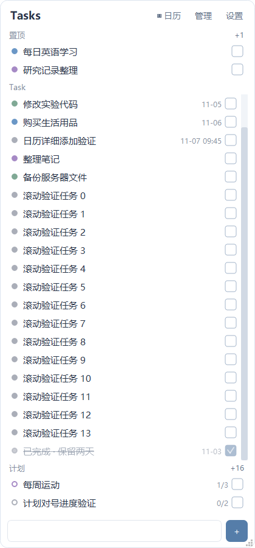
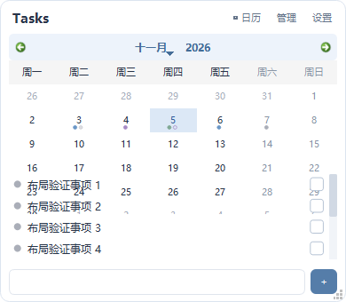
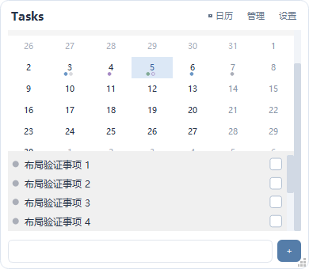

# 窗口布局缺陷验证

关联 #9。修复以 beta 的 3d81ab0 为基线，不包含待处理的 UI 优化。

## 原因与行为
- 悬浮列表原先固定 Task 高度，添加栏位于滚动内容内部；增高后添加栏下方留下空白。现在添加栏固定在底部，Task 使用剩余高度，配置行数作为最小可见高度，空间不足仍可滚动。
- 悬浮日历最小高度与固定四行事项超过窗口可用空间。现在日历和当天事项置于滚动容器内，事项按实际数量占一至四行，添加栏保持可用。
- 隐藏周序号时，Qt 日历第一列为 0。日期命中计算原先假定第一列为 1，导致星期一命中失败；现按实际表头模式计算，覆盖选日与拖放日期定位。

## 验证
2026-11-03，Windows / Qt 5.15.2 / MinGW 8.1，隔离数据库。
- 完整 --self-test 通过：编辑保存与草稿、任务与四种计划规则、完成与置顶、列表滚动、日历改期、SQLite 迁移、JSON 备份恢复及设置。
- 48 个布局组合：两种视图，缩放开/关，0/1/8 条当天事项，390×340、490×446、420×900、630×720。
- 验证内容不重叠、日历表格边界、添加栏底部位置、当天事项高度及小窗口滚动可达性。
- 自检准备阶段校验目标日期单元格，避免错误月份或列偏移造成误判。
- 实际验收仍由使用者完成；未关闭 Issue，未发布安装包。

## 对比截图
全部截图来自虚构测试事项。
| 场景 | 修复前 | 修复后 |
| --- | --- | --- |
| 拉高列表 |  |  |
| 缩小日历 |  |  |
