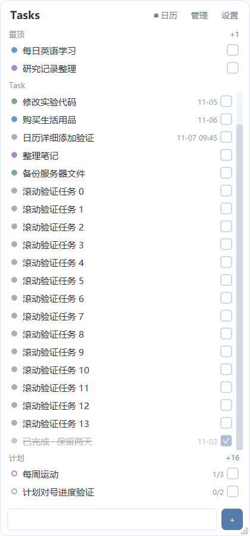
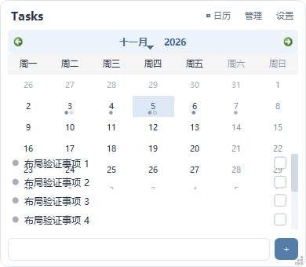
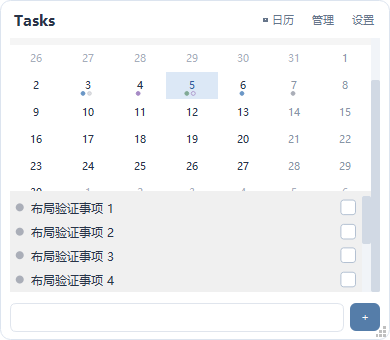

# 窗口布局缺陷验证

关联 #9。修复以 beta 的 3d81ab0 为基线，不包含待处理的 UI 优化。

## 原因与行为
- 悬浮列表原先固定 Task 高度，添加栏位于滚动内容内部；增高后添加栏下方留下空白。现在添加栏固定在底部，Task 使用剩余高度，配置行数作为最小可见高度，空间不足仍可滚动。
- 悬浮日历最小高度与固定四行事项超过窗口可用空间。现在日历和当天事项置于滚动容器内，事项按实际数量占一至四行，添加栏保持可用。
- 隐藏周序号时，Qt 日历第一列为 0。日期命中计算原先假定第一列为 1，导致星期一命中失败；现按实际表头模式计算，覆盖选日与拖放日期定位。

## v2.0.0 之后的补充
- #16：重设计合并（2a6e7fa）曾把当天事项区改回固定四行，现恢复为按事项数占一至四行，空状态占一行，其余高度归日历。日历页内容区改为透明，不再铺一层不跟随窗口不透明度的灰底。
- #15：Qt 日历响应滚轮换月后没有接受事件，页面会随同一事件滚动。悬浮日历不再响应滚轮换月，事件交给页面；月份用上月、下月按钮和标题菜单切换。事项列表先滚动，到头的那次事件只动列表，之后的事件才滚动页面。管理器日历仍可滚轮换月，日期选择弹层的滚轮仍归编辑表单。
- #9 悬浮窗：缩放按面积计算，而日历和列表的最小宽度随之放大，窄而高的窗口会放不下。默认设置下 420 宽的窗口拉到约 700 高就出现横向滚动条，底部多出一条，周日列和换月按钮被挤出。现在内容的最小宽度降到 200（随缩放），跟随窗口缩放的倍数不超过“窗口宽度 ÷ 280”；默认的 420×480、630×720 等比例不受影响。
- #9 编辑面板与独立编辑窗口：备注原先固定 64 像素，其余高度留在表单末尾。现在由备注占用，窗口变矮时先收回备注，再滚动表单。

## 验证
2026-11-03，Windows / Qt 5.15.2 / MinGW 8.1，隔离数据库。
- 完整 --self-test 通过：编辑保存与草稿、任务与四种计划规则、完成与置顶、列表滚动、日历改期、SQLite 迁移、JSON 备份恢复及设置。
- 48 个布局组合：两种视图，缩放开/关，0/1/8 条当天事项，390×340、490×446、420×900、630×720。
- 验证内容不重叠、日历表格边界、添加栏底部位置、当天事项高度及小窗口滚动可达性。
- 自检准备阶段校验目标日期单元格，避免错误月份或列偏移造成误判。
- 实际验收仍由使用者完成；未关闭 Issue，未发布安装包。

## 对比截图
全部截图来自虚构测试事项。
| 场景 | 修复前 | 修复后 |
| --- | --- | --- |
| 拉高列表 |  |  |
| 缩小日历 |  |  |
