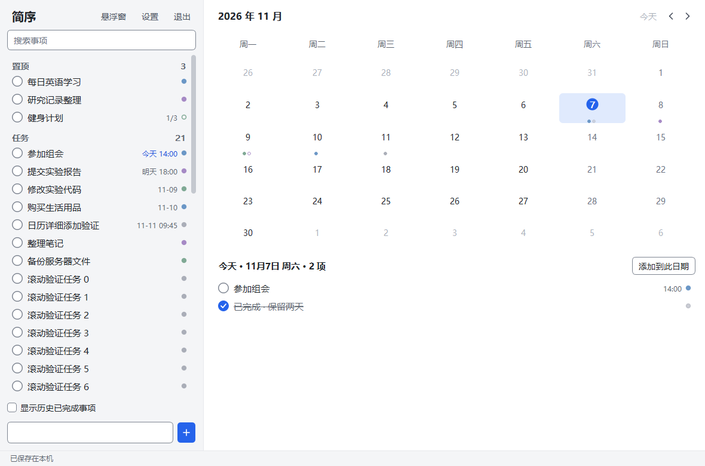
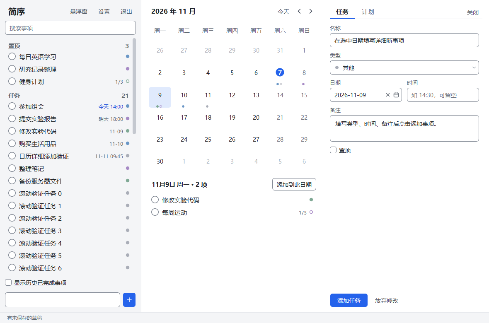

# 重设计 UI 整合

记录日期：2026-11-07。试合并分支：`codex/merge-ui-redesign`。

以 `codex/integrate-pr5-pr11` 的 `f12a276` 为第一父提交，合入 `ui-redesign` 的 `4c3fbfc`，保留双方历史。重设计分支决定主要视觉和布局，整合版提供智能录入、日期编辑保护及原有业务功能。此分支尚待实际试用；应用、qmake 和 CMake 版本沿用 2.1.0，没有新增发布标签或发布包。

## 合并取舍

| 范围 | 最终行为 |
| --- | --- |
| 管理器 | 列表与日历两栏，编辑面板按需打开；关闭面板保留未保存草稿 |
| 列表 | 左侧完成圆圈、右侧类型标记，相对日期与分组计数，空分组隐藏 |
| 悬浮窗 | 任务行数表示首选高度，列表可收缩或利用额外高度，视口只显示完整行；快速添加固定在底部 |
| 日历 | 保留新年月标题、悬停与拖放目标、日期选择器；保留隐藏周序号后的首列命中修复与小窗口溢出滚动 |
| 日期编辑 | 面板关闭时只浏览日历并保留草稿；打开空白面板时按当前浏览日期填表。编辑已有任务时，先激活日期框才允许日历改期；保存后不继续误改原任务 |
| 快速添加 | 使用 SmartEntry 接入新 UI，保留日期时间和中文数字解析、高亮、输入法与撤销，错误或取消时保留输入 |
| 计划与数据 | 保留任务/计划规则、已有数据目录、备份恢复及数据库兼容逻辑 |
| 反馈与缩放 | 沿用新 UI 的状态栏、日期选择按钮和 Windows 文本缩放；智能输入占位符与识别高亮跟随悬浮文字透明度 |

三个冲突文件为 `src/ui.cpp`、`src/settings.cpp` 和 `src/planeditor.cpp`。快速输入回调、日历浏览与编辑意图以及测试断言按上述行为整合。

## 验证

- Windows / Qt 5.15.2 / MinGW 8.1，`build.cmd` 构建成功。
- 完整隔离 `--self-test` 通过，退出码为 0：`run-20261107-005131795`。使用虚构任务与工作目录下的测试数据库。
- 48 组布局用例通过：列表/日历、缩放开关、0/1/8 条日期事项、四种窗口尺寸。检查底部添加栏、日历与列表不重叠、日历末行可访问、完整任务行及长窗口的额外空间利用。
- 通过智能录入解析、中文数字、冲突、取消保留输入、输入法与撤销检查；通过真实鼠标事件驱动的日历日期编辑检查。
- 通过关闭编辑面板后浏览日历保留草稿、重新打开草稿，以及字段清空和日期选择器检查。
- 通过 150% 文本大小模拟、窗口缩放防抖、透明度、任务/计划规则、持久化、迁移、导入导出与备份恢复检查。
- 已检查管理器、编辑面板、悬浮窗、智能录入及小窗口日历截图。真实 Windows 文本大小设置、多屏环境与日常使用体验仍需试用验收。

测试明细与完整截图位于本地 `test-results/run-20261107-005131795/`。下方截图使用虚构测试任务。

## 界面截图

管理器：

编辑面板：

智能快速录入：

